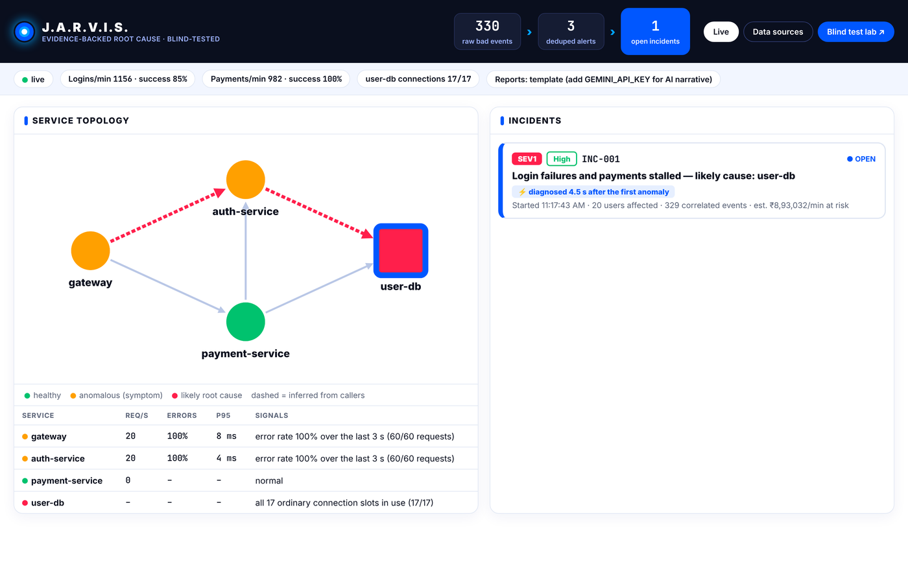
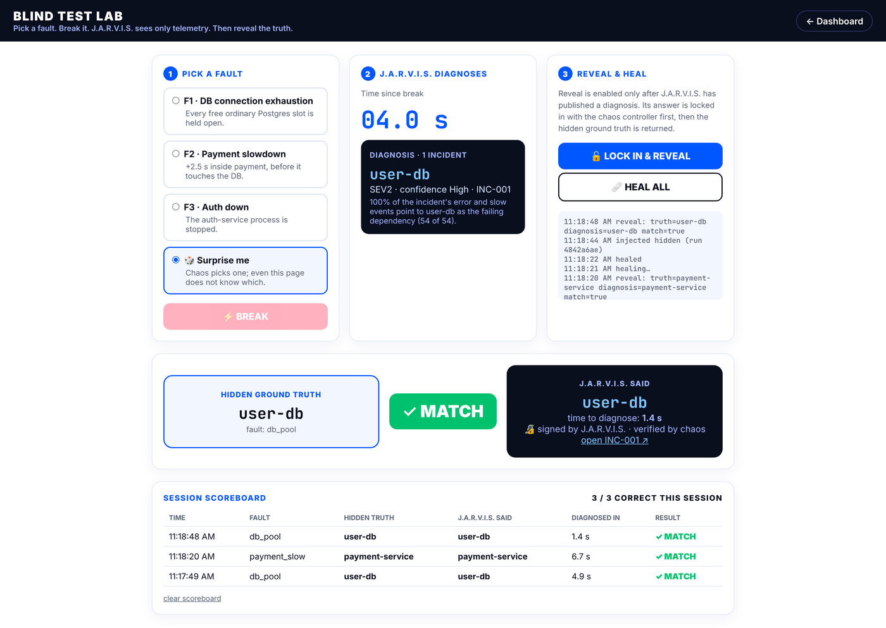
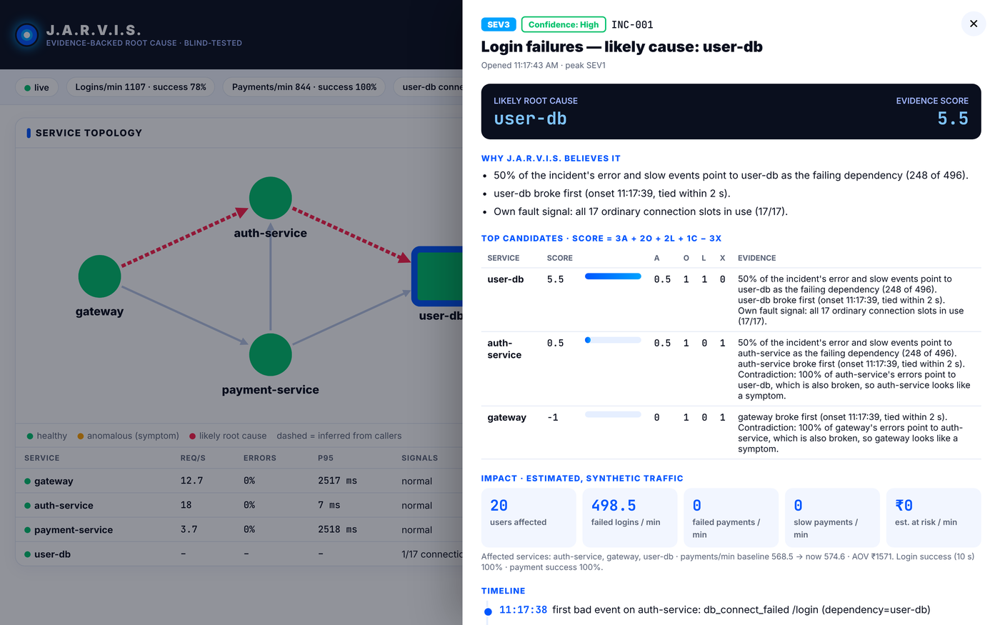
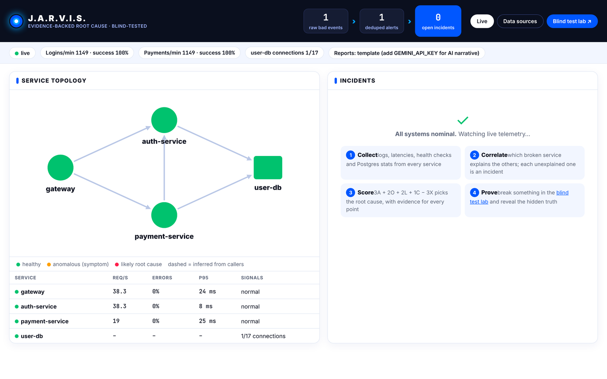
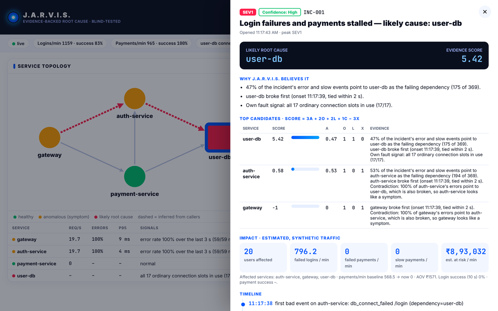
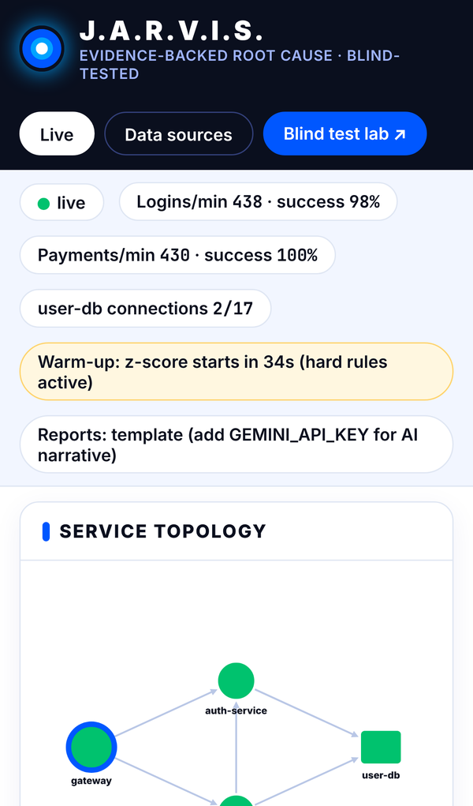

<div align="center">

# J.A.R.V.I.S.

**Justified Analysis, Reasoning & Visualization of Incident Systems**

*From an alert storm to an evidence-backed root cause, proven on blind, judge-chosen failures.*


NITS Hacks 9.0 · Problem Statement 1 · Software Track



</div>

## The problem
When one shared component fails, every service that depends on it raises its own alert. A payment
platform shows **login failures, slow APIs and failed payments at the same time**, and the on-call
engineer chases three fires instead of one cause.

## What J.A.R.V.I.S. does
J.A.R.V.I.S. watches a small but **real** payment platform (gateway, auth, payment, one shared Postgres),
collapses the alert storm into incidents, ranks the root cause **with evidence**, measures the impact
and suggests a fix. A separate chaos controller injects faults **blindly**: J.A.R.V.I.S. sees only
telemetry, and the hidden ground truth is revealed only after it has published a signed diagnosis.

## Try it in 60 seconds
```bash
git clone https://github.com/meenakshisatpathy20-del/JARVIS.git
cd JARVIS
cp .env.example .env      # any random values work; no external API keys needed
docker compose up --build
```
1. Open **http://localhost:8000** and wait for the "Starting up / Warm-up" chip to disappear (~60 s).
2. Open **http://localhost:8000/lab**, pick a fault (or 🎲 *Surprise me*), press **BREAK**.
3. Watch the diagnosis appear, then **LOCK IN & REVEAL** the hidden ground truth.

| Blind test lab | Evidence for every point of the score |
|---|---|
|  |  |

## What makes it different
| | |
|---|---|
| **Evidence-backed diagnosis** | A deterministic scoring engine picks the root cause. The LLM only explains the decision. |
| **Blind fault test** | Chaos keeps the ground truth on its own volume and network. Pick a fault, Break, diagnose, Reveal. Every diagnosis is **signed** by J.A.R.V.I.S. and verified by chaos, so a blind-test win cannot be faked. |
| **Honest by design** | Confidence is shown as words (High / Medium / Not sure), never an uncalibrated percentage. Money figures are labelled estimates. |
| **Does not always blame the database** | A payment-only fault is diagnosed as payment, with the database marked healthy. |

## Results (measured on the Docker stack, 9 Nov 2026)
Across every drill run today (Docker and local, browser and script) J.A.R.V.I.S. diagnosed **13 of 13**
blind faults correctly after the fixes in [docs/JUDGE_REVIEW.md](docs/JUDGE_REVIEW.md). One recorded series:
Blind fault drill (`scripts/fault_drill.py`): chaos injects, J.A.R.V.I.S. diagnoses from telemetry
only, the diagnosis is committed, then the hidden ground truth is revealed.

| Run | Fault | Ground truth | J.A.R.V.I.S. | Confidence | Severity | Time to diagnose |
|---|---|---|---|---|---|---|
| 1 | F1 DB exhaustion | user-db | user-db ✓ | High | SEV1 | 4.5 s |
| 2 | F2 payment slowdown | payment-service | payment-service ✓ | High | SEV2 | 6.3 s |
| 3 | F1 DB exhaustion | user-db | user-db ✓ | High | SEV1 | 4.2 s |
| 4 | F2 payment slowdown | payment-service | payment-service ✓ | High | SEV2 | 6.0 s |
| 5 | F1 DB exhaustion | user-db | user-db ✓ | High | SEV1 | 3.9 s |
| 6 | F2 payment slowdown | payment-service | payment-service ✓ | High | SEV2 | 6.8 s |
| 7 | F3 auth down | auth-service | auth-service ✓ | High | SEV1 | 1.8 s |

7 of 7 correct, 0 phantom incidents after 7 heals. A small sample: this is a demo result, not a
benchmark (15 runs against 4 baselines is planned for the final round). See
[docs/JUDGE_REVIEW.md](docs/JUDGE_REVIEW.md) for the gaps we found in our own build and how we fixed them.

## Quick start (Docker)
```bash
cp .env.example .env          # set any random values; GEMINI_API_KEY is optional
docker compose up --build
```
On Windows PowerShell use `Copy-Item .env.example .env`. Stop with `Ctrl+C`, then `docker compose down`
(`docker compose down -v` also wipes the database and saved incidents).
- Dashboard: http://localhost:8000
- Blind test lab: http://localhost:8000/lab

Let the load generator run **at least 60 s** before injecting anything, so the z-score baseline can warm up.
```bash
curl -X POST localhost:8090/inject -H "Content-Type: application/json" -d '{"fault":"db_pool"}'
curl -X POST localhost:8090/heal
```
Faults: `db_pool` (F1), `payment_slow` (F2), `auth_down` (F3), `payment_slow+auth_down`, `random`.

### Without Docker (fallback)
Needs Python 3.11+ and a local Postgres 16 started with `max_connections=20`.
```bash
pip install -r jarvis/requirements.txt
bash scripts/setup_local_db.sh
bash scripts/run_local.sh          # 'bash scripts/run_local.sh stop' to stop
python scripts/fault_drill.py db_pool payment_slow auth_down
```

## Architecture
```
 loadgen (20 users) ──► gateway ──► auth-service ──► user-db (Postgres 16, max_connections=20)
                           └──────► payment-service ──► auth /verify, user-db
        every service: emit() ──► POST /ingest (batched 1 s)            ▲
                                                                        │ faults (outside J.A.R.V.I.S.'s view)
 J.A.R.V.I.S. (port 8000)                                          chaos (127.0.0.1:8090)
   collector: pg_stat_activity count (1 s) + /health (2 s)          /inject /heal /commit /reveal
   ingest ─► PII scrub ─► normalize ─► dedup (fingerprint)          truth file on chaos-only volume
   ─► detect ─► correlate ─► RCA ─► impact + severity ─► runbooks ─► report (template + Gemini)
   ─► WebSocket ─► dashboard (/) and blind test lab (/lab)
```
Auth and payment both read the same Postgres, so one database fault genuinely breaks login and
payment together. Payment calls auth's `/verify`, so an auth outage also shows up as payment errors.

**Isolation** is enforced by Docker networks: `jarvis` is only on `jarvisnet`, `chaos` only on
`chaosnet`; they share none. Chaos actions never enter J.A.R.V.I.S.'s event stream.

## Fault scenarios
| Fault | Injection | Correct root cause | Evidence J.A.R.V.I.S. cites |
|---|---|---|---|
| F1 DB connection exhaustion | Chaos (non-superuser role `chaos`) holds every free ordinary slot | `user-db` | All 17 ordinary slots in use; auth errors name `dependency=user-db`; DB saturated first |
| F2 Payment slowdown | Token-protected admin endpoint adds 2.5 s before payment opens its DB connection (logs nothing) | `payment-service` | Payment's own latency up while user-db and auth stay healthy; gateway slow only on `/pay` |
| F3 Auth down | Chaos stops the auth container | `auth-service` | Health check down, auth silent while traffic still arrives; gateway and payment errors name `dependency=auth-service` |
| F2 + F3 | Both | see note | Split into two incidents is proven in unit tests only (see Known limits) |

## How the root cause is decided
**Detection** (every second, per service): error rate, p95 latency and request rate from 1-second
buckets (3-second sliding window). Anomaly when a rule fires 3 seconds in a row: z-score ≥ 3 against
a 120 s baseline (after 60 s warm-up), or a hard rule: error rate > 5 %, p95 > 1 s, health check
down, silent while the gateway still sends it traffic, all 17 ordinary DB slots in use, or the DB
monitor cannot read stats.

**Correlation**: for each anomalous service, look at where its error/slow events point (the
`dependency` field, checked against the dependency graph, counting only events since its own
anomaly began). If ≥ 50 % point to an anomalous dependency D, it is a symptom of D. A service no
anomalous dependency explains is a **source**; each source opens one incident. If ≥ 2 services blame
a dependency whose own metrics are missing, that dependency is marked anomalous (inferred). The same
source within 10 minutes reopens its old incident.

**Root cause score** (weights hand-set in `config.yaml` before testing):

`score(s) = 3·A(s) + 2·O(s) + 2·L(s) + 1·C(s) − 3·X(s)`

| Term | Meaning |
|---|---|
| A attribution | Share of the incident's error/slow events that point to s |
| O onset | s broke first (ties within 2 s count for all) |
| L local fault | s shows its own failure: DB slots full, health down, silent, or its own latency rose while its dependencies stay healthy |
| C change | Real deploy/config change on s (final round; chaos actions never count) |
| X contradiction | s is broken but an anomalous dependency explains its errors |

**Confidence**: High = top score ≥ 5, ≥ 2 points ahead, no contradiction. Medium = ≥ 1 point ahead.
Not sure = closer than 1 point; J.A.R.V.I.S. names both candidates and the check that separates them.

**Baselines** shown with every incident: random, most errors, first anomaly, most depended-on.

## Impact, severity, recommendations
- Affected services and users, failed logins / payments per minute, slow payments per minute.
- **Estimated ₹ at risk per minute** = (successful payments/min in the healthy baseline − now) × average
  payment amount. Labelled *estimated, synthetic traffic* everywhere.
- Severity from fixed thresholds (never the LLM): SEV1 login or payment success < 50 % over 10 s;
  SEV2 50–95 % or p95 > 2 s on a core route; SEV3 otherwise.
- Runbook fix per root-cause signature, each citing the evidence it addresses.

## LLM, privacy and fallbacks
The Gemini API (temperature 0, 3 s timeout) receives one structured summary per incident:
severity, ranked candidates with evidence sentences, impact numbers, ≤ 20 timeline items. **No raw
log lines, no user IDs, no per-user amounts.** Free text is scrubbed (cards, emails, phone numbers,
bearer tokens/JWTs) before it is stored or sent. Without a key, or on timeout/rate-limit, a fixed
template report is used. The dashboard never waits for the LLM.

## Three input routes, one schema
| Route | Endpoint | |
|---|---|---|
| Live telemetry | `POST /ingest` | Services batch events every second; collector polls Postgres and /health |
| Log-file upload | `POST /upload` | `.jsonl` as-is; plain text `<date> <time> <LEVEL> [<service>] <message>` with `key=value` pairs; unmatched lines kept as `service=unknown` |
| External alerts | `POST /webhook/alert` | Alertmanager-style JSON (`alerts[].labels.service`, `alertname`, `severity`, `startsAt`) |

Try the upload with `samples/db_pool_incident.log` (Data sources tab).

## Endpoints
| Component | Port | Endpoints |
|---|---|---|
| J.A.R.V.I.S. | 8000 | `GET /`, `GET /lab`, `POST /ingest`, `POST /upload`, `POST /webhook/alert`, `GET /incidents`, `GET /incidents/{id}`, `GET /incidents/{id}/report`, `GET /incidents/{id}/attestation`, `WS /ws` |
| gateway | 8001 | `POST /login`, `POST /pay`, `GET /health` |
| auth-service | 8002 | `POST /login`, `POST /verify`, `GET /health` |
| payment-service | 8003 | `POST /pay`, `GET /health` |
| chaos | 8090 | `POST /inject`, `POST /heal`, `POST /commit` (signed diagnoses only), `GET /reveal` |
| user-db | 5432 | Postgres 16, `max_connections=20` |

## Repository
```
docker-compose.yml   config.yaml   .env.example
db/                  init.sh (roles), schema.sql.txt (tables + 20 synthetic users)
platform/common/     telemetry.py: emit() batches and POSTs to /ingest every 1 s
platform/gateway|auth|payment|loadgen/
chaos/main.py        /inject /heal /commit /reveal; truth file on a chaos-only volume
jarvis/              app.py detect.py correlate.py rca.py impact.py runbooks.py explain.py engine.py collector.py static/
samples/             db_pool_incident.log
tests/test_rca.py    F1, F2, F3, F2+F3, inferred dependency, PII scrub
scripts/             run_local.sh, setup_local_db.sh, fault_drill.py
```
Run the tests: `pip install pytest pyyaml && python -m pytest -q tests`

## Security of the demo
- `/ingest` and `/webhook/alert` require the `x-ingest-token` header (blocks fake telemetry).
- The dashboard and chaos are published on `127.0.0.1` only.
- No external API keys are needed. The values in `.env` are passwords you choose; `GEMINI_API_KEY` is optional.
- Incidents are saved to `incidents.json` (Docker volume `jarvis-data`) and survive a restart.

## Screenshots
| Healthy platform | Incident detail (F1) | Phone |
|---|---|---|
|  |  |  |

## Known limits (honest)
- **F2 + F3 together**: payment cannot verify tokens while auth is down, so its slowdown is masked and
  the live system reports one incident (auth-service). The split of two independent sources is
  proven in `tests/test_rca.py`, not claimed live.
- Detection takes a few seconds by design (3-second runs plus 1-second telemetry batching).
- Everything shares one machine clock. In production we would order events by trace timestamps and
  treat anything within 2 s as a tie.
- All traffic and money figures are synthetic.

## Team
| Name | Role |
|---|---|
| _add name_ | _add role_ |
| _add name_ | _add role_ |

## Roadmap (final round)
Verified remediation for F1 (approve → end hog sessions → verify recovery → escalate if not), a
benchmark of 15 runs against the 4 baselines, browser voice summary, what-if blast-radius preview,
then OpenTelemetry traces and Kubernetes events.
